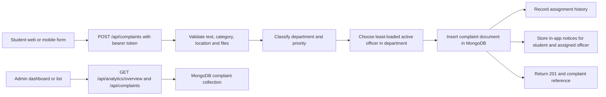

# Complaint Flow Review Report

**Project:** Grievance Management System  
**Review date:** 13 October 2026  
**Review scope:** Student web/mobile submission through API validation, MongoDB persistence, classification, department/officer assignment, notifications, and admin web/mobile visibility.  
**Overall result: PARTIAL PASS**

## Executive summary

The complaint path is implemented end to end. The authenticated create endpoint validates input, classifies and routes the complaint, assigns an active officer when one is available, inserts the complaint in MongoDB, and returns the created complaint and reference ID. The admin complaint APIs read from that same collection, and the admin role is permitted to see all departments. The backend integration suite passed **321 tests** with **1 skipped**.

This review did not access a deployed instance or run a browser against a live deployment. The repository has no open Page context, and no production URL or credentials were provided. Thus deployed MongoDB connectivity, production CORS/auth settings, real email/push delivery, and actual rendered browser behavior could not be confirmed. Code inspection shows the web dashboard loads when opened and does not refresh itself; an admin with the page already open must reload or navigate/filter to fetch new records.

The report reflects the existing working tree, which had numerous pre-existing modified and untracked files. No application code, user data, or existing complaints were changed. The only new file from this review is this report. The test suite used a process-specific test MongoDB database, cleaned by its fixture after the run.

## Complaint flow traced



The admin dashboard retrieves all complaints to build its latest-items section and charts. The complaints page retrieves the paginated admin-visible list. Complaint detail responses include category, department, priority, status, submitter, assigned officer, location, evidence metadata, timeline, resolution and optional lab/system fields. Evidence downloads require authentication and are authorized by complaint visibility.

## Verification results

| Check | Result | Evidence / limits |
|---|---|---|
| Authenticated user can submit | **PASS (automated integration tests)** | `POST /api/complaints` is JWT-protected, validates fields and returns HTTP 201 with a reference. Tests cover success, required auth and invalid input. |
| Complaint is persisted | **PASS (automated integration tests)** | Create path inserts into `complaints`; tests read the created record through API/database and test persistence despite classifier, notification-store and audit failures. |
| Admin can retrieve submitted complaints | **PASS (automated integration tests and code inspection)** | Admin scope is unfiltered; the admin list/dashboard call the complaint API. Role tests verify an admin sees complaints across departments. No live browser/deployment was tested. |
| Details and triage fields | **PASS with limits (code inspection)** | Web detail view renders category, department, priority, status, assigned officer, evidence and timeline. The admin table shows ID/title/submitter/department/officer/priority/status/deadline. No browser rendering was exercised. |
| Attachments | **PASS (backend integration coverage and code inspection)** | Multipart files are validated and stored with metadata; detail view renders evidence, and protected file route checks complaint access. Real browser download and production storage persistence were not verified. |
| New complaint appears without refresh | **FAIL for automatic update (code inspection)** | Dashboard fetches on page entry; the list fetches on entry and on list interactions. No polling, SSE or WebSocket refresh was found. An already-open web admin page can remain stale until reload/navigation or a list interaction triggers a fetch. Mobile dashboard supports initial refresh, pull-to-refresh and refresh after returning from a child screen; it is not live-pushed. |
| Role/access boundaries | **PASS (automated integration tests)** | Student complaint reads are limited to their own records; officers are limited to their department/queue; admin can view all. Admin-only assignment and officer status restrictions are tested. |
| Assignment/routing | **PASS for covered routing; conditional manual queue** | Tests verify water and electricity routing, officer assignment, cross-department isolation and assignment actions. Computer/lab persistence is covered in current tests. The classifier is rule-based and may choose a department from keywords; if no active officer exists in the chosen department, the complaint remains unassigned for admin action. |
| Notifications/status updates | **PASS for in-app flows; external delivery unverified** | Tests verify student submission notice, officer assignment notice, resolution notice, read state and notification privacy. Email and push are optional configuration paths; no real provider delivery was tested. Status changes persist and notify the complainant in code and test coverage. |
| All categories and roles | **PARTIAL** | The full suite passed. Category mapping/classification tests cover the existing categories’ routing logic, while end-to-end creation tests exercise representative categories (including Water, Electricity and Computer/Lab), not a live submission for every category in every client. Role coverage includes student, officer and admin. |

### Automated test run

Command:

```text
.venv\Scripts\python.exe -m pytest backend/tests -q
```

Result:

```text
321 passed, 1 skipped, 1 warning in 666.10s (0:11:06)
```

The skipped case is the OTP development-mode security case, which self-skips when the environment `.env` enables `OTP_DEV_MODE`. The warning was a `PytestCacheWarning` because pytest could not create its cache node-ID path; it did not fail tests. Existing tests include complaint creation, persistence, role restrictions, cross-department routing, assignment, lifecycle updates, notifications, file behavior and resilience.

## Findings

### F-1 — Web dashboard does not refresh new complaints automatically

**Severity: P2 — operational visibility**  
**Type: Confirmed by code inspection; not browser-tested.**

The dashboard calls its loaders once on page initialization. The shared complaint list reloads when opened or when a filter, sort or page action triggers a request, but there is no periodic refresh or push subscription. A complaint is still retrievable after a new request, but an administrator who leaves the page open will not see it arrive in-place.

**Reproduction:** Open the admin dashboard/list in one browser session. Submit a complaint as a student in another session. Wait on the admin page without interacting. The existing DOM has no code path that fetches the new row. Reload the page or trigger a list interaction; the new request should return it.

**Recommended fix:** Add bounded polling, server-sent events, or an explicit refresh control with a visible last-updated time. Keep manual reload available and avoid aggressive polling.

### F-2 — Dashboard KPI links do not show all statuses counted by each KPI

**Severity: P2 — misleading triage view**  
**Type: Confirmed by code inspection.**

The admin metrics aggregate lifecycle states (for example, `inProgress` includes `Assigned` and `Accepted`), but the cards link to exact `status=Pending`, `status=In Progress` and `status=Resolved` filters. The backend also has a `statusGroup` filter, but these dashboard links do not use it. Clicking a count can therefore show fewer records than the count represents. Similar metric definitions differ between the analytics summary and complaint-statistics service.

**Reproduction:** Create/retain complaints in `Assigned`, `Accepted`, `Under Review`, and `Closed` states. Note the dashboard KPI values, then click each KPI. The exact-status list will omit some statuses counted by the KPI.

**Recommended fix:** Define lifecycle groups once and use the same membership for KPI aggregation and card filters. Add a regression test that compares each admin KPI with the results opened by its link.

### F-3 — Assignment-history write can fail after the complaint itself is committed

**Severity: P2 — user-visible false failure / possible duplicate retry**  
**Type: Confirmed by code inspection; failure path not injected during this run.**

The service inserts the complaint document first, then records the automatic assignment history without catching errors. If the assignment-history collection/write fails, the request can return an error even though the complaint is already visible in MongoDB and to the admin. A student may retry, creating a second complaint. Notification writes are explicitly best-effort, but assignment-history writes are not.

**Reproduction:** In an isolated integration test, make `assignment_service.record_assignment` raise after assignment is selected, submit a valid complaint, then inspect both the response and `complaints` collection. The expected failure mode from the current call order is a failed response with a persisted complaint document.

**Recommended fix:** Make complaint creation and assignment-history persistence atomic where supported, or treat assignment history as best-effort while recording an operational error and returning the committed complaint/reference. Add a regression test to ensure the response cannot imply “not saved” after commit.

### F-4 — Computer/Lab details are dropped when classification chooses another department

**Severity: P2 — complaint metadata/routing inconsistency**  
**Type: Confirmed by code inspection; conflict case not covered by current tests.**

For category `Computer/Lab`, the web/mobile forms collect and submit `lab` and `systemNumber`, and the validator requires them. The service only persists those values when the final classified department is exactly `MCA Lab / Computer Lab`. Since keyword classification can override the selected category’s default department, a Computer/Lab submission with conflicting text can pass validation, route elsewhere, and silently lose its lab/system fields. The detail screen then has no values to display.

**Reproduction:** Submit category `Computer/Lab`, select a lab and system number, and use title/description with strong water/electricity/building keywords. If the classifier routes to that other department, inspect the returned complaint and detail view; the submitted lab/system values will be absent.

**Recommended fix:** Persist validated lab/system values for the category regardless of the chosen department, or reject/ask the user to confirm a category/department mismatch before submission.

### F-5 — No new-complaint notification is sent to administrators

**Severity: P3 — missing notification channel**  
**Type: Confirmed by code inspection.**

On submission, the notification service stores an in-app notice for the complainant and, if auto-assigned, the officer. It does not notify an administrator. This does not prevent dashboard retrieval, but it removes an alert path for new complaints, especially if no active officer was available.

**Reproduction:** Submit a complaint, then inspect the admin user’s notification feed. The submission helper creates notices for the student and assigned officer only; no admin recipient is selected.

**Recommended fix:** If admin alerts are part of the intended workflow, notify a configured admin/grievance-cell group or provide a reliable dashboard unread/new-count indicator. Ensure delivery remains best-effort so notification failure cannot undo a complaint.

### F-6 — Shared JWT signing value is present in the environment template

**Severity: P1 — authentication/security configuration**  
**Type: Confirmed by code inspection; production use not verified.**

`backend/.env.example` contains a fixed JWT signing value despite the config and README describing the signing key as required and user-generated. If a deployment copies the example and leaves the value in place, separate deployments share a publicly disclosed signing key, weakening token trust. This is an authentication risk; it does not by itself prevent valid submissions from reaching the admin.

**Reproduction:** Inspect line 18 of `backend/.env.example`; it contains a concrete value rather than an empty placeholder or generation instruction. No production environment was available to determine whether it is currently used.

**Recommended fix:** Remove the fixed value from the template, require a unique generated secret, and rotate any deployed secret that may have been derived from the template. Keep the startup check that refuses an unset secret.

## Items not verified against a live system

- Production MongoDB availability, indexes, credentials, write permissions and stored complaint records.
- Actual cross-origin browser behavior for the deployed host and its configured CORS allow-list.
- Real SMTP and FCM delivery. The code makes these optional; default config disables both channels unless configured.
- Browser-rendered admin pages and protected evidence downloads in a deployed session.
- Automatic update behavior in production beyond the code finding that no web refresh mechanism is implemented.
- End-to-end form submission for every category in both web and mobile clients. Automated suite coverage is broad but not an exhaustive UI matrix.

## Recommended remediation order

1. Remove the fixed JWT signing value from the example and rotate any environment using it.
2. Prevent a post-commit assignment-history failure from returning a misleading submission failure.
3. Align admin KPI totals and their destination filters; include status-group regression coverage.
4. Add a refresh mechanism or clear manual refresh indicator to the web dashboard.
5. Preserve Computer/Lab metadata across classifier/category mismatches.
6. Decide whether admins require submission alerts and implement that channel if required.
7. Validate the deployed API, database, CORS and external notification settings in a staging or production-like browser session.

## Final verdict

**PARTIAL PASS — the backend complaint flow is supported by passing integration tests and complaints are retrievable by admins, but the web dashboard does not update automatically and the findings above leave operational and data-consistency gaps.** Production receipt and real notification-provider behavior remain unverified without access to the deployed system.
